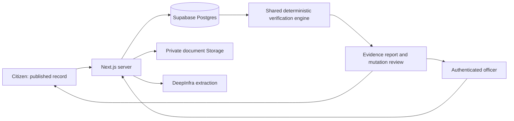

# BhumiSetu — Round 1 build plan and live checklist

Updated: 17 October 2026. Target: a focused 30-minute implementation sprint after the external services are ready. This is a time budget, not a claim that an untested complete system can be guaranteed in 30 minutes.

## Outcome and judging story

**Primary submission problem: P3 — Catch Fraud & Double-Selling.** The rulebook requires choosing one problem. P1 digitization, P2 document comparison, P4 mutation review, and P5 citizen reporting support this one coherent solution.

**Pitch:** “BhumiSetu connects fragmented land documents and explains conflicts before a buyer pays or an officer approves a mutation.”

Demo one parcel: 20 decimals recorded; Abdul Karim sells 12 decimals to Rahima Begum in deed 502/2021 and 12 to Karim Uddin in deed 889/2022; a mutation references the second deed. Show the impossible 24/20 allocation, the two source deeds, the rule calculation, and a hearing-required case. All people and records in this scenario are fictional.

Success means a reviewer can change a real stored record, reload the page, see the audit history and recalculated evidence, and follow the same result through the officer and citizen views.

## Sources and decisions

- `architecture_&_ui_ux.pdf`, 35 pages: master land container; four document categories; multiple uploads per subtype; extraction/review/audit; separate publication; source-linked history; citizen comparison and missing-data coverage. Pages 26–29 specify the fictional conflict fixture.
- `master_instructions.md`: actual master brief. `master_prompt.md` does not exist. Its 16-hour checklist is input to this plan, not a feasible 30-minute scope promise.
- `Hackathon_Overview.md` and original `landtech_hackathon_rulebook.pdf`: October 18 submission; concept PDF ≤3 pages; public code with setup/data/AI disclosure; demo ≤90 seconds; live URL recommended. The separate judging rubric is not supplied, so no scoring weights are assumed.
- Existing scaffold is published at https://github.com/AdribMahmud101/bhumisetu. Baseline lint, typecheck, build, and Firefox smoke test previously passed.
- Preserve the user's PDF replacement/removal in the working directory. Do not restore the removed historical PDF or change unrelated files.

## Stack: decide once and build

| Layer | Decision | Purpose |
| --- | --- | --- |
| App | Existing Next.js 14 App Router, React 18, strict TypeScript | One deployable app; server routes/actions for privileged work |
| Install/runtime | Bun 1.4 + committed `bun.lock`; Node runtime on hosting | Fast cached installs; existing build is verified |
| UI | Tailwind, existing shadcn-compatible utilities, Lucide | Consistent tables, cards, dialogs, forms; no component generator dependency |
| State | Server data + local React state + URL tabs | Keep displayed results tied to persisted records |
| Data/storage | Supabase Postgres + private Storage | Durable records, private original files, transactional changes |
| Authentication | Supabase Auth + `@supabase/ssr`; server-checked officer role | Real officer login; citizen reads published projections only |
| Validation | Add `zod` | Validate uploads, extraction output, corrections and state transitions |
| AI extraction | Existing OpenAI SDK → DeepInfra; configurable vision model | Extract fields from actual document pages; preserve null/uncertain values |
| PDF | Existing `pdfjs-dist` for text/page rendering; native PDF preview | Local worker; send bounded pages to vision; source beside fields |
| Integrity | Node `crypto` SHA-256 of original bytes | Exact-copy comparison with an enrolled document; not proof of legal title |
| QR | Existing `qrcode.react`; lazy-load `html5-qrcode` | Open a published record; optional camera/image scanning after core flow |
| Report | Print stylesheet + browser Save as PDF first | Bangla-compatible, source-linked dossier with QR and timestamp |
| Testing | Bun unit tests for rules; Playwright Firefox for workflows | Existing Firefox installation avoids another large browser download |
| Hosting | Existing public GitHub → Vercel Node deployment | Live app after local checks; requires a connected hosting account |

Only planned package additions: `zod` and `@supabase/ssr`. Reuse installed dependencies. Defer maps, blockchain, vector databases, agent frameworks, general chatbots, extra chart libraries, microservices and framework migration. Draw the quota meter and risk gauge with CSS/SVG. Model IDs come from environment configuration and must pass one live request; old IDs in the brief are not assumed available.

## Architecture and trust boundaries

- Keep API/service-role keys in server-only modules. RLS stays enabled. Browser role switches change navigation only; authorization is enforced on every privileged server operation.
- Separate the pure `analyzeRecords(land, documents)` function from the server `analyzeMasterLand(id)` loader. P3, P5 and mutation decisions consume this single engine.
- Database writes use transactions/RPCs where consistency matters. An update trigger records each changed extracted field, old/new values, reason, authenticated actor and timestamp in the same transaction. Application roles cannot update/delete audit rows. This is append-only at application privilege level, not a claim of protection against a database administrator.
- Verifying a sale deed creates one draft mutation case with a unique source-deed constraint. Re-verification cannot duplicate it. Analysis is refreshed when relevant verified records change; approval always rechecks current records.
- Verification is per document. Publication is a separate master-land action. Stable ID allocated at draft creation; QR resolves only a published projection. Private originals use authorized, short-lived signed URLs; QR cannot bypass access checks.
- Persist timestamps, document revision and analysis rule version on reports. Zero detected signals is distinct from complete checks or legal clearance.

## Data contract

| Entity | Minimum stored fields |
| --- | --- |
| `master_lands` | Internal UUID, unique land ID, district/upazila/mouza/JL/dag/khatian, recorded area, draft/published state, publication timestamp |
| `land_documents` | Master FK, code, category, subtype, original title/survey, official number, dates, parties, dag, area/share identity, mutation deed reference, extraction JSON, field provenance/page, review status, storage path, SHA-256 |
| `audit_logs` | Document, actor, field, previous/new value, required reason, timestamp; append-only application access |
| `mutation_cases` | Unique source-deed FK, applicant, requested area, computed signals, review status, officer decision/reason, revision |

Four categories: KHATIAN, PORCHA, DEED, MUTATION. All allow multiple documents per subtype. Keep original document title and survey separate because the PDF uses inconsistent Porcha subtype examples. Missing extracted values remain nullable; do not populate invented defaults or confidence numbers.

Documents: UPLOADED → EXTRACTING → PENDING_REVIEW → VERIFIED / NEEDS_CORRECTION; failed extraction retains the original and a visible retry state. Editing a verified material field invalidates verification until reviewed again. Mutations: AUTO_INITIATED → HEARING_REQUIRED / READY_FOR_REVIEW → APPROVED / REJECTED. Approval requires officer authorization, required evidence and no unresolved conflicts; a zero score alone is insufficient. Any generated order is clearly a prototype document, not an official DCR or government certificate.

## Rule contract: resolve the conflicting examples now

1. **Excess/overlapping sale +40:** group verified sale deeds by confirmed parcel and seller; compare unique transfers against that seller's recorded available area. Do not add Khatian and Porcha areas together. Equal areas alone do not prove the same share. Exclude duplicate imports using document identity/hash; explicit matching share/boundary evidence can establish overlap even without an excess total.
2. **Ownership history conflict +25:** seller contradicts the available chronological ownership chain for the parcel/share. Missing history produces an uncertainty flag, not an invented conflict. Mere repeated seller names do not trigger this rule.
3. **Deed–mutation conflict +20:** a verified mutation references the later conflicting sale while an earlier competing sale exists for the same established parcel/share. Show the mutation and both deeds.
4. **Timeline anomaly +15:** registration before execution, or a documented onward transfer within the declared prototype window (30 days). Missing dates do not trigger points. A rapid-transfer rule is a review signal, not proof of wrongdoing.

Each rule contributes once; repeated evidence is deduplicated; total is capped at 100. Normalize Bangla digits, whitespace, dates and units. Compute areas in hundredths of a decimal to avoid floating-point comparisons. Match parcel context, not a dag number alone. Uncertain linkage becomes “Further verification required.”

**Canonical fixture: 60/100 = 40 excess sale + 20 mutation conflict.** The seller is in the prior Khatian; dates do not satisfy the timeline rule. The brief's hardcoded 65/85 values must not reach application code or seed score columns. Returned evidence includes both deeds, the supporting baseline, the mutation and missing checks. Add a separate clean fixture and an incomplete fixture; never label either “safe to buy.”

## Screens and visual direction

Use a polished records workspace: deep forest green navigation, warm ivory background, restrained red for conflicts, clear Bangla labels paired with concise English, readable numbers, strong spacing, responsive layout. Make evidence and next actions prominent. No fake national statistics, government seals, simulated processing delays or dead controls.

| Route | Main interaction |
| --- | --- |
| `/` | Clear promise, citizen search, sample-record shortcut, officer entry |
| `/verify` | Search by internal land ID; exact-copy document check; optional scan |
| `/verify/[id]` | Land summary, four category counts, quota meter, computed report, source comparison, history tabs, print dossier |
| `/admin` | Authenticated master-land list, pending reviews, create draft |
| `/admin/land/[id]` | Four upload categories/subtypes; split source/extracted review; required correction reason; audit; finalize/publish |
| `/admin/mutations` | Computed case queue; conflicting deeds; hearing/decision actions |
| `/login` | Officer login, explicit authentication errors |

The quota meter shows 12 + 12 against 20, including a visible 4-decimal overflow. Every alert links to its evidence. History distinguishes a recorded entry, deed and mutation; latest recorded party is derived from a dated source, never called the confirmed legal owner.

## Thirty-minute execution checklist

Check a task only after its acceptance condition is met. Record failures and actual verification below. Work in dependency order; do not replace an unavailable backend with fake successful responses.

### 0. Plan and baseline — complete

- [x] Review architecture/UX PDF, master brief and original rulebook.
- [x] Select P3 focus, lock stack and resolve score to 60 from rules.
- [x] Confirm public scaffold and prior validation results.
- [x] Write this implementation tracker.

### 1. Foundation and database — target minutes 0–6

- [ ] Install the two additions; define validated domain types and category configurations.
- [ ] Write migration, RLS, private bucket, audit trigger and transactional review functions.
- [ ] Create fictional conflicting, clean and incomplete fixtures with idempotent seed script; generate clearly watermarked sample PDFs and store actual hashes.
- [ ] Configure Supabase + DeepInfra locally; apply migration; seed and reload records from Postgres.
- [ ] Add officer session/authorization; confirm anonymous writes and private reads fail.

Acceptance: stored records survive a reload; public access cannot call officer operations; secrets stay absent from client bundles and Git.

### 2. Deterministic core — target minutes 6–10

- [ ] Implement shared engine and its server loader with evidence, coverage and analysis version.
- [ ] Unit tests: conflict=60, clean=0 with coverage, incomplete=uncertain; duplicate import; equal-area distinct shares; unrelated parcels; baseline duplication; ownership/date signals; pending-record exclusion.
- [ ] Implement exact SHA-256 match plus structured field comparison statuses: Matched / Mismatch found / Further verification required.

Acceptance: score comes from input data, never fixture ID; changing verified evidence changes the output.

### 3. Complete reading experience — target minutes 10–17

- [ ] Build workspace shell, real search, empty/not-found/error states and mobile layout.
- [ ] Build citizen record, category lists, source-linked timeline and side-by-side deed evidence.
- [ ] Add quota overflow, score breakdown, missing court/khas/acquisition coverage, next steps and QR link.
- [ ] Add print dossier with rule version, evidence references, timestamp, QR and indicative-report label.

Acceptance: both conflicting and clean records can be searched; every displayed count/result comes from stored records; source links open real fixture documents.

### 4. Real document-to-decision loop — target minutes 17–25

- [ ] Upload PDF/image to private storage; validate size/type, hash originals; support multiple per subtype.
- [ ] Extract selectable PDF text and render scanned pages using a local PDF.js worker; cap prototype input at 5 MB / 3 pages and disclose that limit.
- [ ] Call DeepInfra with actual content; validate output; preserve page/source and unknown values; show retryable provider errors.
- [ ] Build source/extracted review; persist corrections with reason and transactional audit; verify document.
- [ ] Auto-create/recompute mutation case and hearing status; enforce server-side decision checks.
- [ ] Publish reviewed master data separately; confirm public report reflects the new verified evidence.

Acceptance: upload → actual extraction → correction → audit → verification → recomputed conflict → hearing-required mutation works end to end. Existing reviewed synthetic records keep the report usable if the provider is unavailable; do not present them as a newly processed upload.

### 5. Verification and handoff — target minutes 25–30

- [ ] Run lint, typecheck, production build and core unit tests.
- [ ] Playwright: search/report; upload/review/audit persists; duplicate verification creates one case; conflict blocks approval; unpublished record hidden; unauthorized mutation rejected.
- [ ] Capture desktop/mobile review; fix the demo path before adding features.
- [ ] Update README with real setup, datasets, AI tools, implemented scope and service limits; commit/push without secrets.
- [ ] Deploy when hosting credentials are available; repeat the core smoke test against deployed URL.
- [ ] Draft the ≤90-second demo script and ≤3-page concept-note outline. Team/mentor details and recording/submission remain human inputs.

## Time and service gates

- **Immediate external dependencies:** Supabase URL/service-role key, an available database setup path, one officer account, DeepInfra key and funded/available model. Keys go in `.env.local`, never chat or repository.
- Without credentials, continue schema, engine, tests, UI and sample generation. Connected extraction/storage/mutation acceptance remains unchecked until actual service calls pass. Do not silently substitute localStorage or hardcoded API responses.
- At minute 17, prioritize the evidence report and the real review-to-mutation path. Defer voice, camera scanning, broad translation, complex PDF layouts and cosmetic animation if core work needs the time.
- If deployment or provider access is blocked, preserve a tested local demonstration and document the precise blocker. A deployed claim requires testing the actual URL.
- Full legal workflows, government integration, comprehensive handwriting accuracy and production security certification are beyond this sprint. No government scraping or citizen data.

## Ninety-second demo sequence

| Seconds | What the judges see |
| --- | --- |
| 0–10 | Problem and promise: one plot sold twice; open the fictional parcel |
| 10–30 | 20 recorded vs 24 sold; two deeds side by side; 60/100 explained |
| 30–55 | Officer reviews an extracted document against its PDF; correction and audit persist |
| 55–70 | Verification refreshes the mutation dossier; conflict requires a hearing |
| 70–85 | Citizen opens QR-linked report with history, evidence and explicit missing checks |
| 85–90 | “AI reads; rules explain; officers decide.” Show working repository/live link |

Keep provider latency outside the critical narration by using already processed, honestly labeled synthetic documents; demonstrate a live extraction separately if it fits. No simulated result or edited claim of a live government response.

## Implementation log

| Stage | Status | Evidence / blocker |
| --- | --- | --- |
| Published baseline | Complete | Public `main`; prior lint/typecheck/build/Firefox smoke passed |
| Plan/source review | Complete | This document; original PDF/rulebook reviewed |
| Connected services | Pending | Credentials/setup question sent; values not inspected or printed |
| Database and core | Pending | No implementation or new checks claimed |
| Product UI/workflows | Pending | Existing landing page remains a scaffold |
| Deployment/submission | Pending | Repository publication is complete; app deployment is separate |

## Technical references checked

- Next.js server/client boundaries: https://nextjs.org/docs/app/getting-started/server-and-client-components
- Supabase database functions: https://supabase.com/docs/guides/database/functions
- Supabase RLS: https://supabase.com/docs/guides/database/postgres/row-level-security
- DeepInfra image/OCR interface: https://docs.deepinfra.com/chat/vision

## Implementation update — 17 October

The core app is implemented and deployed at https://bhumisetu.adribmahmud.workers.dev. See `TODO.md` and README for actual validation and limitations. Cloudflare deployment required moving from Next.js 14 to supported Next.js 15.5.28 and adding the OpenNext/Workers tools. Officer auth uses the existing Supabase SDK and server-validated HttpOnly sessions. The existing browser suite now uses Firefox. Full camera scanning/voice assistance remain deferred. This update supersedes the original Vercel hosting choice and pending implementation rows above.
